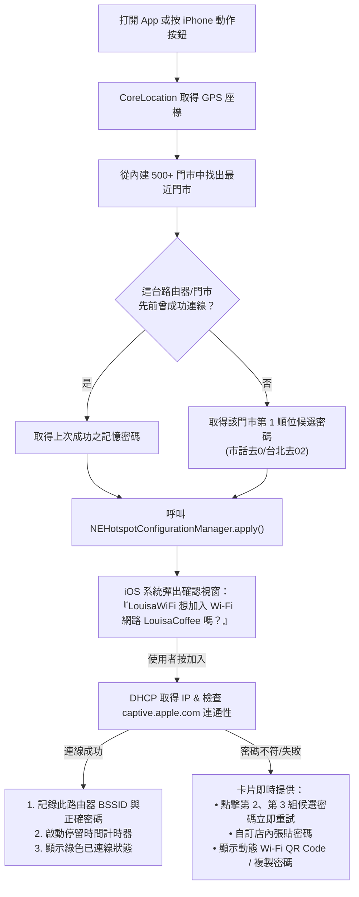

<p align="center">
  
</p>

# ☕ Louisa Wi-Fi for iOS

> **走進全台任何一家路易莎咖啡，iPhone 智慧辨識門市並一鍵連上 Wi-Fi。**  
> 不用問店員密碼，不用手動切換設定，更不用每次都「忘記此網路設定」！

本專案為 macOS 知名開源工具 [madeyexz/louisa-wifi](https://github.com/madeyexz/louisa-wifi) 的 **原生 iOS 移植與全新架構重構版（SwiftUI + NEHotspotConfiguration + AppIntents）**，專為 iPhone 實機安裝使用打造。

---

## 💡 為什麼需要 iOS 版？核心痛點是什麼？

全台灣 500 多家路易莎咖啡的 Wi-Fi SSID 全都叫 **`LouisaCoffee`**，但每家門市的密碼不同（通常為該門市的市內電話號碼變體）。

iOS 系統內建的 Wi-Fi 機制有兩個硬性限制：
1. **單一 SSID 只能記住一組密碼**：當您在 A 店連過 Wi-Fi，走到 B 店時，iPhone 會嘗試用 A 店的舊密碼連線並失敗卡住。使用者必須進入「設定 → Wi-Fi」，手動按 ⓘ 點選「忘記此網路設定」，再重新點選並手動輸入 B 店密碼。
2. **`.mobileconfig` 描述檔無法解決**：iOS 設定描述檔（Configuration Profile）無法為同一個 SSID 指派多組不同密碼與門市規則，且不具備 GPS 運算邏輯。

**Louisa Wi-Fi iOS 版** 結合 iPhone 的 CoreLocation 定位與 Apple 原生 `NEHotspotConfigurationManager` API，讓 iPhone 能在您抵達門市時：
- 📍 **GPS 精準辨識**：自動計算距離您最近的門市、公尺數與地址。
- ⚡ **一鍵覆寫連線**：利用 `NEHotspotConfiguration` 直接將目前門市密碼寫入系統並加入連線，**完全不需要手動忘記網路**！
- 🚀 **極速觸發體驗**：支援「打開 App 自動彈出系統確認框」與「iPhone 動作按鈕 / 捷徑」一鍵觸發。
- 📊 **GitHub 風格連線熱度圖**：精準記錄您在路易莎的停留時段與到訪門市排行榜。

---

## 📱 運作架構與連線邏輯

iOS 對於 Wi-Fi 連線與後台執行有嚴格的沙盒限制（不允許像 macOS CoreWLAN 那樣在背景無感輪詢嘗試密碼）。因此，本 App 採用了針對 iOS 最佳化的高效互動決策架構：



---

## 📂 專案目錄與各資料夾／檔案說明

本儲存庫採用清晰分層的模組化目錄結構，每個目錄與檔案皆具備明確職責：

| 目錄 / 檔案 | 職責與用途說明 |
| :--- | :--- |
| **`LouisaWiFi/`** | **iOS 原生 App 核心原始碼目錄（SwiftUI 5.9+ / iOS 17+）** |
| ├─ `App/` | App 生命週期入口點（`LouisaWiFiApp.swift`），監聽系統前背景狀態切換與會話結算。 |
| ├─ `Models/` | 領域資料結構：門市資訊（`Store.swift`）、路由器記憶快取（`LearnedStoreCache.swift`）與連線時數累計（`UsageTracker.swift`）。 |
| ├─ `Services/` | 核心系統服務：Wi-Fi 連線與 Captive Portal 驗證（`WiFiConnector.swift`）、GPS 門市測距定位（`LocationManager.swift`）與資料庫快取同步（`StoreRepository.swift`）。 |
| ├─ `Views/` | 四大主要頁面：連線首頁（`ConnectView.swift`）、門市搜尋（`StoreListView.swift`）、連線方格圖統計（`StatsView.swift`）與設定（`SettingsView.swift`）。 |
| ├─ `Views/Components/` | 複用 UI 組件：門市焦點卡片（`StoreCardView.swift`）、GitHub 風格連線熱度方格圖（`HeatmapGridView.swift`）與離線掃描 QR Code 視窗（`WiFiQRCodeModal.swift`）。 |
| ├─ `Intents/` | Apple 原生捷徑與動作按鈕整合（`LouisaIntents.swift`），支援 Siri 語音呼叫。 |
| └─ `Resources/` | 專案資源清單：官方女神 Logo 圖示資產（`Assets.xcassets`）、內建門市資料庫（`stores.json`）、隱私權說明（`Info.plist`）與網路權限簽章（`LouisaWiFi.entitlements`）。 |
| **`data/`** | **全台門市離線資料庫（`stores.json`）**，收錄全台 500+ 家門市名稱、市話、經緯度與自動推算之候選密碼清單。 |
| **`scripts/`** | **自動化更新維護腳本（`fetch_stores.py`）**，負責每週爬取路易莎官方網站最新門市資料與推算密碼變體。 |
| **`docs/`** | **專案文件與架構決策記錄**：包含官方視覺圖示（`icon.png`）與 `adr/`（0001、0002、0003 核心技術決策文件）。 |
| **`.github/`** | **GitHub Actions 自動化工作流（`workflows/update-stores.yml`）**，每週一自動定時執行爬蟲更新門市資料庫。 |
| **`LouisaWiFi.xcodeproj`** | 乾淨生成的 Xcode 專案檔案，支援點擊直接以 Xcode 開啟部署。 |
| **`project.yml`** | [XcodeGen](https://github.com/yonaskolb/XcodeGen) 聲明式專案規格設定檔，確保建置設定透明且無衝突。 |
| **`CONTEXT.md`** | 領域模型（Domain Model）與統一詞彙定義文件。 |
| **`README.md`** | 本專案之繁體中文完整說明文件與安裝指南。 |

---

## ✨ 主要功能特色

### 1. ☕ 「連線」首頁
- **目前 Wi-Fi 狀態橫幅**：顯示目前連線狀態、是否能正常上網、路由器 BSSID、以及中斷按鈕。
- **最近門市焦點大卡片**：顯示最近門市名稱、即時距離（例如 `85 公尺`）、地址與電話。提供醒目的 **「☕ 一鍵連上此門市」** 大按鈕。
- **候選密碼膠囊清單**：列出該店的 2~3 組候選密碼（以星號標記曾驗證成功的密碼），輕點任一組即可直接指定該密碼發起連線；長按支援複製密碼與開啟 QR Code。
- **附近門市清單**：即時列出周圍第 2 ~ 5 家最近門市供手動切換。

### 2. 🔍 「門市」搜尋頁
- 收錄全台 500+ 家路易莎完整資料庫（名稱、市話、地址、GPS 座標、候選密碼）。
- 支援**縣市快速篩選標籤**（台北市、新北市、台中市...）與即時搜尋欄。
- 支援**「手動自訂密碼連線並記住」**：若個別加盟店自訂了非電話變體的特殊密碼，輸入一次連線成功後，App 將自動記住這台路由器與密碼！

### 3. 📊 「統計」頁面（GitHub 風格連線方格圖）
- 移植自 Mac 版熱門功能，專為 iPhone 觸控螢幕重新設計。
- 顯示 **連線熱度方格圖**，方格顏色隨當日停留時間加深。
- 統計指標：**到訪天數**、**造訪門市數**、**最長連續天數**、**平均每日停留時數**。
- 提供「門市時數排行條狀圖」、「月份時數長條圖」與「年份排行」，點擊任一門市即可單獨篩選該店歷史紀錄。

### 4. ⚙️ 「設定」頁面
- **打開 App 自動彈出連線**（預設開啟）：走進店裡只要點一下 App 圖示，完全不用找按鈕，立即跳出系統連線框！
- **雲端同步門市資料庫**：可隨時從 GitHub Raw 下載全台最新門市名單與修正。
- **路由器記憶管理**：可隨時檢視或清除已記住的路由器紀錄與重置統計。

### 5. ⚡ iOS 捷徑與動作按鈕整合 (`AppIntents`)
- 內建 `ConnectNearestLouisaIntent`（連上最近的路易莎 Wi-Fi）。
- 支援 iOS「捷徑」App、iPhone 15 Pro / 16「動作按鈕（Action Button）」、控制中心快捷鍵與 Siri 語音呼叫。

---

## 🛠️ 開發環境與技術規格

- **開發語言**：Swift 5.9+ / SwiftUI
- **目標系統**：iOS 17.0+
- **專案結構**：使用 [XcodeGen](https://github.com/yonaskolb/XcodeGen) 管理 `project.yml`，並附帶乾淨的 `LouisaWiFi.xcodeproj`
- **核心框架**：
  - `NetworkExtension` (`NEHotspotConfigurationManager`, `NEHotspotNetwork`)
  - `CoreLocation` (GPS 距離計算)
  - `AppIntents` (iOS 捷徑與動作按鈕)
  - `CoreImage.CIFilterBuiltins` (動態 Wi-Fi QR Code 生成)

---

## 📲 個人安裝與 Xcode 簽章教學（實機安裝 Step-by-Step）

本 App 供個人實機安裝使用，請依照以下步驟使用 Mac 上的 Xcode 將 App 部署到您的 iPhone：

### 準備工作
1. 一台運行 macOS 的電腦，並安裝最新版 **Xcode**（App Store 免費下載）。
2. 一條傳輸線將您的 iPhone 連接到 Mac（或開啟 Wi-Fi 區域網路部署）。
3. 一個 Apple ID（免費用戶的個人帳號 Personal Team 即可進行實機安裝測試）。

---

### 步驟 1：下載或複製本專案
```bash
git clone https://github.com/zpqnzpqn/louisa-wifi-ios.git
cd louisa-wifi-ios
```

### 步驟 2：使用 Xcode 開啟專案
在 Finder 中點兩下開啟 `LouisaWiFi.xcodeproj`（或在終端機執行 `open LouisaWiFi.xcodeproj`）。

> 💡 如果您有安裝 `xcodegen`（`brew install xcodegen`），隨時可以執行 `xcodegen generate` 重新由 `project.yml` 產生最新的專案檔。

---

### 步驟 3：設定您的 Apple 開發者簽章 (Signing)
1. 在 Xcode 左側導覽列，點選最上方的藍色專案圖示 **`LouisaWiFi`**。
2. 在中間視窗選取 Target **`LouisaWiFi`**，並切換到 **`Signing & Capabilities`** 頁籤。
3. 勾選 **`Automatically manage signing`**。
4. 在 **`Team`** 下拉選單中，選取您的 Apple ID（例如 `Your Name (Personal Team)`）。
   - *如果選單中沒有帳號，點選「Add an Account...」並登入您的 Apple ID 即可。*
5. 在 **`Bundle Identifier`** 欄位：
   - 預設為 `io.github.zpqnzpqn.LouisaWiFi`。
   - 若 Xcode 提示 Identifier 已被佔用，請稍微更改後綴（例如加上您的英文名字或生日，如 `io.github.zpqnzpqn.LouisaWiFi.myphone`）。

---

### 步驟 4：了解 Capabilities 與免付費 Apple ID 備用方案

本專案配置了兩項 Entitlement 權限：
1. `Hotspot Configuration`：用於呼叫 `NEHotspotConfigurationManager` 自動加入 Wi-Fi。免付費個人 Apple ID 亦可在開發除錯模式下在實機安裝運行。
2. `Access WiFi Information`：用於讀取路由器 `BSSID`。
   - **如果您使用的是付費 Apple Developer 帳號**：此兩項功能皆可完整啟用。
   - **如果您使用的是免費個人 Apple ID**：若 Xcode 提示無法為個人 Team 簽發 WiFi Information 權限，您可以在 `Signing & Capabilities` 視窗中點選 `Access WiFi Information` 右側的 `×` 移除該權限。
     - **備用無損體驗**：即使移除該權限，App 依然會使用 GPS 找出門市並以第一順位密碼執行一鍵連線；同時 App 內建了**「動態 Wi-Fi QR Code」**與**「複製密碼」**功能，隨時都能在不需任何特殊權限下完成連線！

---

### 步驟 5：信任開發者憑證並安裝至 iPhone

1. 在 Xcode 頂部工具列將執行目標選取為您的實體 **`iPhone`**。
2. 點擊 **▶ (Run)** 或按鍵盤 `Cmd + R` 開始編譯並安裝至手機。
3. 第一次在實機上執行時，iOS 會提示「不受信任的開發者」：
   - 請在 iPhone 上開啟「**設定 → 一般 → VPN 與裝置管理**」。
   - 在「開發者 APP」底下點選您的 Apple ID，並按下「**信任**」。
4. 回到 iPhone 桌面打開 **Louisa Wi-Fi**，允許「**定位權限**」，大功告成！🎉

#### 💡 一次設定，終身免插線（Wi-Fi 隔空安裝教學）
插線完成首次安裝後，建議順手開啟無線除錯功能：
1. 保持手機接線狀態，在 Xcode 頂部選單開啟 **`Window → Devices and Simulators`**（快捷鍵 `Cmd + Shift + 2`）。
2. 在左側選取您的 iPhone，勾選右側的 **「Connect via network」**（透過網路連線）。
3. 拔掉傳輸線！此時 Xcode 右上方依然會顯示您的 iPhone（旁邊帶有小地球/Wi-Fi 圖示）。日後只要手機與 Mac 連在同一個 Wi-Fi 下，按 `Cmd + R` 即可直接隔空將 App 編譯推送到手機上，再也不用翻找傳輸線！

---

## ⚡ 打造極速連線體驗

### 1. 打開 App 自動彈出連線
在 App 內「設定」中確保 **「打開 App 自動彈出連線」** 為開啟狀態（預設已開啟）。  
走進任何一家路易莎，點開桌面上的 Louisa Wi-Fi 圖示，**不需要按任何按鈕**，iOS 會立即精準辨識該門市並跳出系統「加入 LouisaCoffee」確認框，按一下「加入」即可上網！

### 2. 綁定 iPhone 動作按鈕 (Action Button)
1. 打開 iPhone「**設定 → 動作按鈕**」。
2. 左右滑動切換到「**捷徑 (Shortcut)**」。
3. 點選並搜尋選擇「**連上最近的路易莎 Wi-Fi**」（由 Louisa Wi-Fi 內建提供）。
4. 之後只要踏進路易莎，長按手機側邊的動作按鈕，立即自動定位並發起連線！

---

## 🔑 密碼推算規則說明

全台路易莎門市的 Wi-Fi 密碼通常由門市電話衍生而來。App 內建的密碼推算邏輯如下（以最可能順位排列）：
1. **雙北門市（02 開頭）**：
   - 順位 1：去開頭 02 區碼（例如市話 `02-2700-1234` → 密碼 `27001234`，最普遍）。
   - 順位 2：完整號碼帶 02（例如 `0227001234`）。
   - 順位 3：去開頭 0（例如 `227001234`）。
2. **其他縣市（非 02 開頭）**：
   - 順位 1：去開頭 0（例如市話 `04-2345-6789` → 密碼 `423456789`）。
   - 順位 2：完整號碼（例如 `0423456789`）。
   - 順位 3：市話後 8 碼。

---

## 🤖 GitHub Actions 雲端自動更新門市

本儲存庫配置了全自動化的 [`.github/workflows/update-stores.yml`](.github/workflows/update-stores.yml)，專門負責維持全台門市資料庫的最新狀態。

### 1. 每週固定排程（全自動，電腦不需開機）
- **定時排程**：`cron: '0 2 * * 1'`（每週一 UTC 02:00，即台灣時間每週一上午 10:00）。
- **自動運行**：GitHub 雲端主機會自動喚醒並執行爬蟲腳本 [`scripts/fetch_stores.py`](scripts/fetch_stores.py)，抓取路易莎官網最新門市與座標。若資料有變更，自動以 `github-actions[bot]` 身份將新資料提交推送至儲存庫。

### 2. 隨時手動觸發更新（支援網頁與終端機）
如果您想立即手動更新資料庫：
- **方式 A（網頁端）**：
  1. 開啟儲存庫首頁，點擊頂部的 **「Actions」** 標籤。
  2. 在左側選取 **「Update Stores Data」** 工作流。
  3. 點選右側的 **「Run workflow」** 下拉選單並按下綠色按鈕，約 20 秒內自動完成更新！
- **方式 B（GitHub CLI 指令）**：
  ```bash
  gh workflow run update-stores.yml
  ```

### 3. iPhone App 端的無感熱更新（免重新編譯）
當 GitHub 儲存庫上的 `data/stores.json` 更新後，使用者完全不需要重新打包安裝 App：
- 打開 iPhone 上的 **Louisa Wi-Fi** App。
- 進入 **「設定」** 頁籤，點擊 **「立即從 GitHub 同步最新門市」**。
- App 會自動自 GitHub Raw 下載最新門市清單並寫入手機快取，即使人在外面也能立即連上剛開幕的新門市！

---

## 🔒 隱私權聲明

1. **零追蹤、零上傳**：本 App 完全不設後台伺服器，不蒐集任何個人資訊。
2. **定位資訊**：僅在 App 使用期間或執行連線捷徑時於本機運算距離您最近的門市，定位資料絕不傳輸至任何外部網路。
3. **安全透明**：完全開源，所有程式碼均使用純 Swift 與 Apple 原生框架實作。

---

## 🙏 致謝

- 感謝 macOS 原版作者 **madeyexz** 打造的 [madeyexz/louisa-wifi](https://github.com/madeyexz/louisa-wifi)，啟發了本專案的誕生，並提供了門市資料結構與密碼推算概念。
- 本專案門市資料版權歸路易莎咖啡官方所有。
